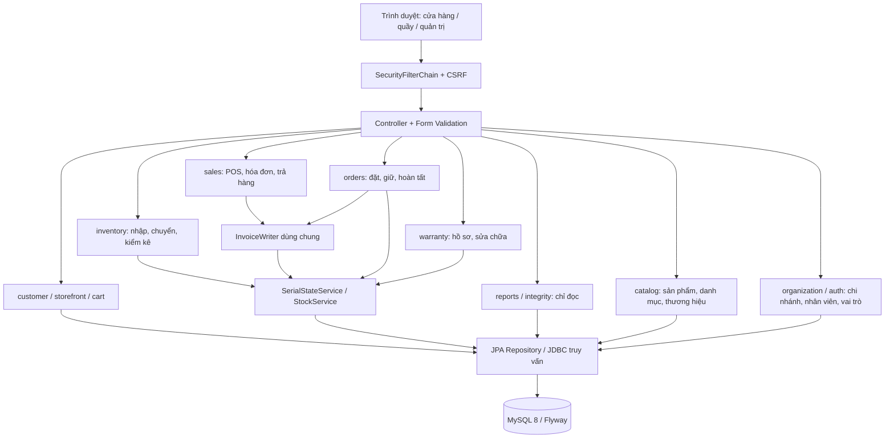
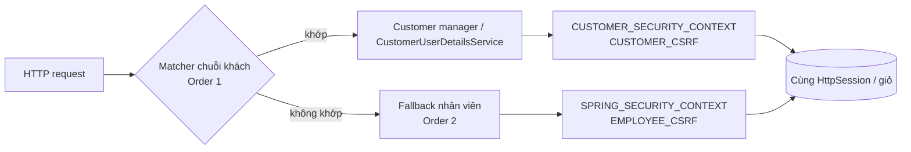
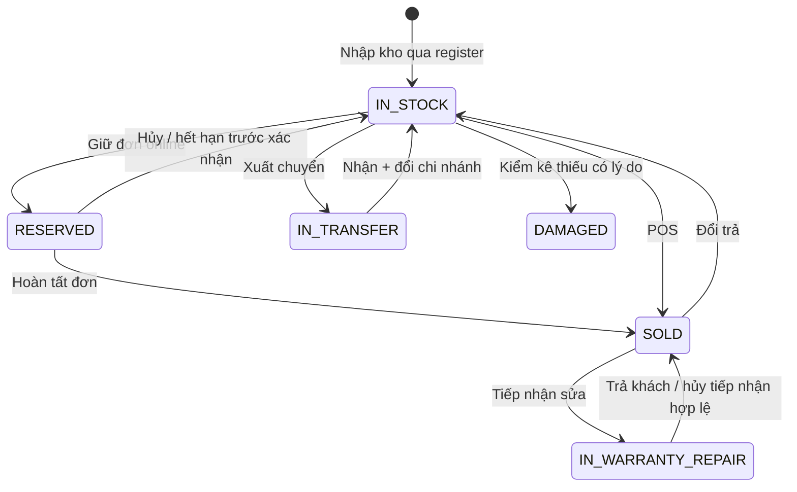

# Kiến trúc hệ thống

Ứng dụng Java 21/Spring Boot 3 là một monolith chia module theo nghiệp vụ, Maven build một JAR. MySQL 8 lưu dữ liệu, Flyway quản lý schema; Thymeleaf/Bootstrap 5 dựng giao diện, JavaScript thuần xử lý tương tác. Ảnh upload ở volume ngoài classpath. Không có microservice, gateway thanh toán thật hoặc Python trong runtime nghiệp vụ; script Python cũ chỉ là công cụ kiểm tra lịch sử, smoke 10C dùng Bash.

## Module và hướng gọi

Đây là sơ đồ trách nhiệm/gọi chính, không phải danh sách đầy đủ mọi dependency Java. Form/View DTO và mapper viết tay tách entity khỏi template. Controller kiểm tra input và chuyển lỗi nghiệp vụ thành form/flash/404; service quyết định quyền chi nhánh và transaction. Repository lấy dữ liệu, các truy vấn tổng hợp reports dùng JDBC/projection để tránh kéo entity hàng loạt.

## Hai SecurityFilterChain

Chuỗi thứ nhất nhận `/`, `/products/**`, `/search`, `/register`, `/customer/**`, `/account/**`, `/cart/**`, `/checkout/**`, `/orders/**`, `/warranty/**` và tài nguyên/trang lỗi công khai. `/account`, `/checkout`, `/orders` cần ROLE_CUSTOMER; giỏ cho phép ẩn danh. Chuỗi thứ hai nhận phần còn lại, `/login` nhân viên, `/staff`, `/admin`, `/inventory`, `/pos`, `/reports`; chỉ GET health được công khai trong Actuator.

Request chỉ chạy **chuỗi đầu tiên khớp**, không gộp quyền hai tài khoản. Mỗi chuỗi có AuthenticationManager/UserDetailsService, SecurityContextRepository, CSRF repository, saved request và bộ đếm login riêng. Đăng nhập đổi session ID chống fixation nhưng giữ thuộc tính, cho phép cùng một trình duyệt có cả phiên khách và nhân viên. Logout chỉ xóa context/CSRF tương ứng, không invalidate toàn session hay xóa giỏ. ActiveEmployeeFilter kiểm tra nhân viên bị khóa mỗi request; không làm mất phiên khách.

## Luồng Serial

Bảng chuyển duy nhất ở `SerialStatus`, mọi thay đổi trạng thái qua `SerialStateService`. Chuyển trạng thái hợp lệ vẫn phải qua điều kiện nghiệp vụ/chứng từ; sơ đồ không cấp quyền đổi trực tiếp. `DAMAGED` hiện không có lối chuyển ra. Mỗi mốc có serial_history, actor EMPLOYEE/CUSTOMER/SYSTEM, chứng từ và from/to chi nhánh. Hàng phụ kiện không Serial dùng stock_quantity và stock_movement.

## Quyết định thiết kế và lý do

| Quyết định | Lý do và hệ quả |
|---|---|
| Snapshot giá lúc đặt/bán | Giá order_item/invoice_item là cam kết tại thời điểm giao dịch; thay catalog không được đổi hóa đơn cũ. Hoàn tất online dùng giá order_item, không lấy lại giá mới. |
| Snapshot tháng bảo hành | invoice_item.warranty_months là nguồn tính end_date từ ngày bán. Dữ liệu cũ NULL được audit báo “chưa đủ dữ liệu”, không suy ngược từ catalog hoặc end_date. |
| Tiền là số nguyên VND | Service từ chối phần lẻ, không tự làm tròn đầu vào; CHECK hỗ trợ bảo vệ các cột đã có ràng buộc. BigDecimal/DECIMAL giữ tính chính xác; không chuyển tiền sang double. |
| Hoàn tiền phần dư lớn nhất | Phân bổ theo số đã thu còn lại từng payment, floor rồi chia các đồng dư theo phần thập phân lớn nhất. Mỗi lần tổng hoàn khớp tuyệt đối và không vượt số còn lại; giữ đúng phương thức gốc. |
| Khóa bi quan theo thứ tự ID | POS, giữ hàng, chuyển, trả và hoàn tất khóa tài nguyên trước khi kiểm tra lại. Khi khóa nhiều Serial theo ID tăng dần, các transaction tranh cùng tài nguyên theo cùng thứ tự, giảm vòng chờ gây deadlock; không khẳng định loại bỏ mọi deadlock DB. |
| Version + khóa header | Form mang version để phát hiện màn hình cũ; khóa dòng đơn phối hợp nhân viên, khách hủy và expiry job rồi kiểm tra lại trạng thái/hạn. Thất bại trả thông báo tải lại, không âm thầm ghi đè. |
| Idempotent token + request hash | Checkout/order guard và UNIQUE DB chặn bấm đúp/cạnh tranh; token đã dùng phải khớp người dùng, phạm vi và nội dung. Không dùng lại token với giỏ khác để lấy chứng từ cũ. |
| Một transaction mỗi thao tác nghiệp vụ | Chứng từ, Serial, lịch sử, tồn, payment và warranty cùng commit hoặc rollback. Không cập nhật trạng thái kho riêng rồi tạo hóa đơn sau ngoài giao dịch. |
| InvoiceWriter dùng chung | POS và hoàn tất online dùng cùng cơ chế lập hóa đơn/thu tiền/bảo hành; tránh hai bản code khác quy tắc. UNIQUE invoice.order_id chốt mỗi đơn tối đa một hóa đơn. |
| Thu online tách sổ mô phỏng | order_payment ghi tiền đã thu trước khi có invoice; khi hoàn tất mới tạo payment tương ứng. Báo cáo không cộng đồng thời hai bảng thành doanh thu, tránh đếm hai lần; cổng thanh toán thật là phần chưa triển khai. |
| Giữ hàng có sổ và hết hạn | Serial RESERVED, phụ kiện reserved_qty; khả dụng không gồm phần đã giữ. Xác nhận bỏ expires_at/reserved_until; job không tự nhả đơn đã xác nhận, chỉ hàm releaseReservation xử lý hủy hợp lệ. |
| Phân quyền ở service | Ẩn nút không đủ bảo vệ endpoint. Service giới hạn chi nhánh theo actor, chứng từ ngoài phạm vi trả 404; các ngoại lệ ADMIN và tra Serial xuyên chi nhánh được quy định rõ từng use case. |
| Actor đa loại, không FK đa hình | actor_type/id phân biệt nhân viên, khách, hệ thống; SYSTEM có ID NULL. Một cột không thể FK đồng thời nhiều bảng, nên service kiểm tra actor phù hợp và DB CHECK kiểm hình dạng. |
| DTO/projection và fetch có chủ đích | Entity LAZY không đi thẳng ra view. EntityGraph/join fetch hoặc projection lấy đúng quan hệ và tổng hợp theo lô, tránh N+1 khi phân trang/đếm tồn theo chi nhánh. |
| SKU/tên thống nhất DB và service | SKU trim/uppercase trước kiểm tra trùng và lưu. Tên category/brand dùng utf8mb4_0900_as_ci: không phân biệt hoa thường nhưng phân biệt dấu; DB unique và service cùng ý nghĩa. |
| Flyway và DDL tách app | Migration đã chạy không sửa; thay schema bằng version mới, Hibernate không tự tạo bảng. User app chỉ DML; user migration riêng có DDL, tránh cấp root cho runtime. |
| Ảnh ngoài classpath | UUID + kiểm định phần mở rộng/content-type/kích thước ngăn dùng đường dẫn tên file gửi lên. Volume giữ ảnh qua redeploy; đồng bộ transaction dọn ảnh mới khi rollback và ảnh cũ sau commit. Backup SQL phải đi kèm ảnh. |
| Clock chung, múi giờ Việt Nam | Ngày bán, history, bảo hành và expiry dùng Clock inject Asia/Ho_Chi_Minh; báo cáo lọc khoảng nửa mở. Demo chỉ replay trên thread loader rồi restore, không UPDATE SQL ngược ngày hoặc để Clock giả cho request/job. |
| Audit chỉ đọc | 12 SELECT kiểm bất biến độc lập với đường ghi, tối đa 20 ID ví dụ, không lộ PII. Mỗi INV có test tiêm lỗi SQL để chứng minh audit có thể đỏ; dữ liệu snapshot cũ thiếu bằng chứng được báo riêng. |
| Monolith theo module | Một transaction MySQL đủ cho các thao tác liên module của đồ án, dễ chạy/debug/bảo vệ hơn phân tán. Nếu mở rộng nhiều instance cần Redis cho login limiter/rate limiter và thiết kế vận hành phù hợp, không chỉ nhân bản container. |

Các giới hạn cần nêu khi bảo vệ: chưa có gateway tiền thật, chưa chứng minh hiệu năng p95 toàn trang trên tải sản xuất, chưa kiểm thử HA/khôi phục thảm họa ngoài bài thử cục bộ. Kiểm thử tự động/khói không thay kiểm thử thủ công toàn bộ UI. Nguồn chi tiết: SecurityConfig, SerialStatus/SerialStateService, CheckoutService/InvoiceWriter, OrderLifecycleService/StaffOrderService, ReturnService, docs/testing.md và docs/performance.md.
